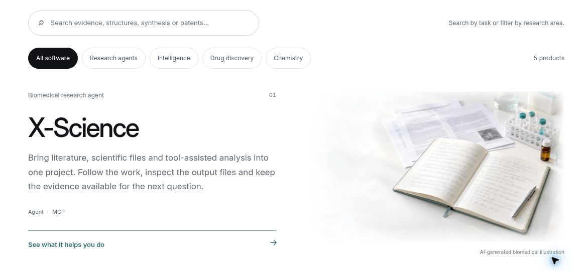

# X-UI · X-Science website

Explore scientific software and research agents built by Victor Xu. Find a tool for the question in front of you, understand what it can produce and continue to its official guide.

**[Explore x-science.ai](https://x-science.ai)**

*The public website, captured on 15 October 2026.*

## Find the right starting point

- **[X-Science](https://github.com/Victor-Xu-1/X-Science)**: organize literature, scientific files and tool-assisted analysis around a research question, with outputs available for review
- **[X-Pharma](https://github.com/Victor-Xu-1/X-Pharma)**: connect pharmaceutical research, patent and deal records with traceable sources
- **[X-DDE](https://github.com/Victor-Xu-1/X-DDE)**: prepare molecular inputs, run configured research tasks and compare candidates through linked tables and 2D / 3D results
- **[X-Synth](https://github.com/Victor-Xu-1/X-Synth)**: explore ASKCOS synthesis routes and review reaction steps alongside starting-material evidence
- **[X-PatentSAR](https://github.com/Victor-Xu-1/X-PatentSAR)**: turn supported WIPO patent PDFs into reviewable structure–activity records and exported research materials

Each product page explains its audience, practical uses, outputs, installation environment and scope, with a direct path to the project's maintained documentation.

## Explore in your language

The website is available in **English, 简体中文, 日本語, Deutsch, Français and 한국어**. English is the default, and changing languages keeps you on the same product.

Search and category filters help narrow the catalog. A workflow explorer and product use cases connect common research needs to relevant tools. Core content, links and language selection remain usable without JavaScript; keyboard navigation and reduced-motion preferences are supported.

*Search, filter and open a product's guide. The card artwork is labeled as an AI-generated illustration.*

## See the context, then open the guide

Biomedical illustrations and interactive molecular views provide visual context for the software. Editorial images are conceptual; deposited-coordinate views are illustrations, with camera motion rather than molecular simulation.

This is a public software portfolio. It does not run the scientific applications or accept research data. To use a tool, follow its official installation guide and check its model, data, hardware and licensing requirements.

Product descriptions reflect a reviewed source snapshot. The linked project documentation is the place to confirm current availability and capabilities.

## License

Original website code, documentation and artwork are [MIT licensed](LICENSE), copyright 2026 Victor Xu. Reused assets retain their original licenses and attribution in [THIRD-PARTY-NOTICES.md](THIRD-PARTY-NOTICES.md).

Each promoted application keeps its own repository's license. The website's license grants no rights to third-party data or to represent another organization as X-Science.

